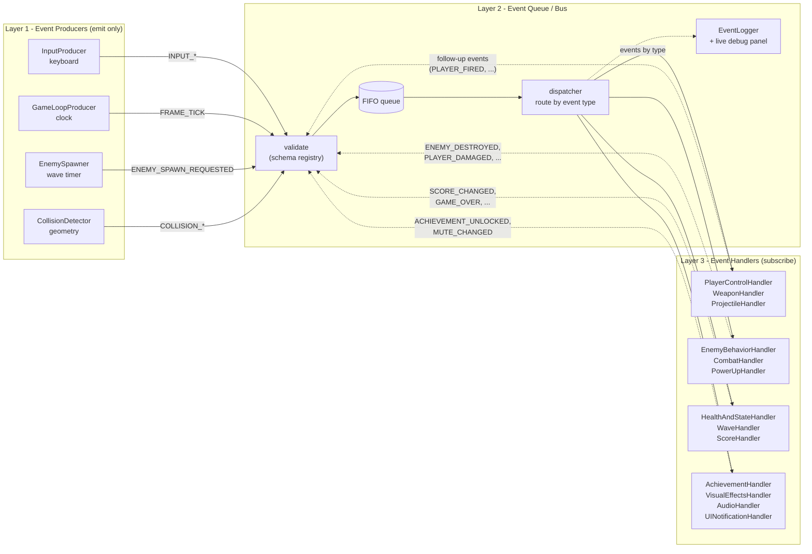
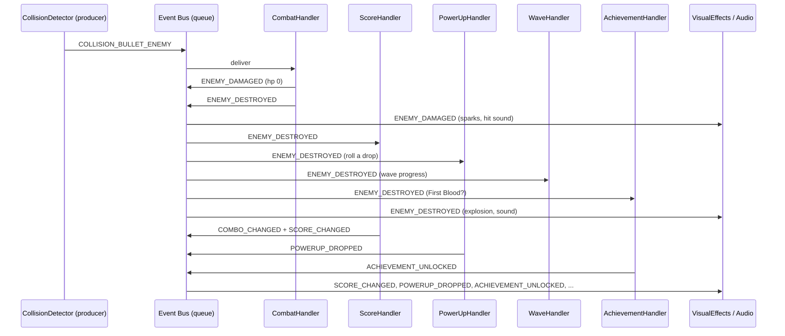

# Architecture

Event Horizon is built as a strict **event-driven architecture**. No game component calls another one. Everything that happens in the game is an **event** that travels through one central **event queue (the Event Bus)**:

```
Event Producers  ──▶  Event Queue / Bus  ──▶  Event Handlers
(things that happen)  (buffer, validate,       (things that react)
                       route, observe)
```

The full list of events (43) is in [events.md](events.md).

## 1. The big picture



The same thing as plain ASCII:

```
 LAYER 1: EVENT PRODUCERS              LAYER 2: EVENT QUEUE / BUS                LAYER 3: EVENT HANDLERS
 (emit events, subscribe to nothing)   (src/core/EventBus.js)                    (subscribe by event TYPE)

 +--------------------+                +--------------------------------+
 | InputProducer      |-- INPUT_* ---->|                                |------> PlayerControlHandler
 +--------------------+                |  1. validate against registry  |------> WeaponHandler
 +--------------------+                |     (type, producer, payload)  |------> ProjectileHandler
 | GameLoopProducer   |-- FRAME_TICK ->|  2. clone + freeze payload     |------> EnemyBehaviorHandler
 +--------------------+                |  3. append to FIFO queue       |------> CombatHandler
 +--------------------+                |  4. process(): pop in order,   |------> PowerUpHandler
 | EnemySpawner       |-- ENEMY_SPAWN->|     deliver to every handler   |------> HealthAndStateHandler
 +--------------------+   _REQUESTED   |     subscribed to that type    |------> WaveHandler
 +--------------------+                |  5. tell observers who got it  |------> ScoreHandler
 | CollisionDetector  |-- COLLISION_* >|                                |------> AchievementHandler
 +--------------------+                +---------------+----------------+------> VisualEffectsHandler
                                                       |   ^                ----> AudioHandler
                                                       |   |                ----> UINotificationHandler
                                             tap (read-only)  |
                                                       v   |                 handlers publish FOLLOW-UP events
                                        EventLogger -> DebugPanel / console  back into the same queue:
                                        (live demo of the flow)              (PLAYER_FIRED, ENEMY_DESTROYED,
                                                                              SCORE_CHANGED, GAME_OVER, ...)
```

## 2. The three layers

### Layer 1 - Event producers

A producer observes something (a key, the clock, a timer, the geometry of the world) and publishes an event describing it. It never knows who is listening and never subscribes to anything.

| Producer | File | Publishes | Notes |
|---|---|---|---|
| `InputProducer` | `src/producers/InputProducer.js` | `INPUT_MOVE_CHANGED`, `INPUT_FIRE_CHANGED`, `INPUT_PAUSE_PRESSED`, `INPUT_START_PRESSED`, `INPUT_MUTE_PRESSED` | Reports changes of intent only, not raw key repeats |
| `GameLoopProducer` | `src/producers/GameLoopProducer.js` | `FRAME_TICK` | The game clock; silent while paused |
| `EnemySpawner` | `src/producers/EnemySpawner.js` | `ENEMY_SPAWN_REQUESTED` | Own timer; reads the current wave, never creates an enemy |
| `CollisionDetector` | `src/producers/CollisionDetector.js` | `COLLISION_BULLET_ENEMY`, `COLLISION_PLAYER_ENEMY`, `COLLISION_ENEMY_BULLET_PLAYER`, `COLLISION_PLAYER_POWERUP` | Pure geometry; applies no damage |

### Layer 2 - Event queue / bus

`src/core/EventBus.js` (+ `events.js`, `EventLogger.js`). On `publish(type, payload, source)` it:

1. looks the type up in the **event registry** (`src/core/events.js`) and checks that `source` is the component allowed to produce it and that every required payload key is present (violations throw in strict mode, warn once otherwise);
2. clones the payload through JSON and **deep-freezes** it;
3. wraps it in an envelope `{ id, event_type, timestamp, source, payload }` and **appends it to the FIFO queue**. Nothing is delivered yet.

On `process()` it pops events in order and calls every handler subscribed to that type. Events that handlers publish while running are appended to the same queue and handled in the same cycle (breadth-first, so ordering is deterministic). A handler that throws does not prevent the others from receiving the event. A safety valve (`maxPerCycle`) stops runaway event loops.

The bus also offers a `tap()` hook: after each dispatch, observers learn *which handlers received the event*. The `EventLogger` and the on-screen `DebugPanel` use it to show the flow in real time; no game logic depends on it.

### Layer 3 - Event handlers

Independent classes (all extend `EventHandler`) that subscribe to event **types** and react. Each one owns a slice of the game state and is the only code that may write it.

| Handler | Owns (writes) | Reacts to | Publishes |
|---|---|---|---|
| `PlayerControlHandler` | player position / movement intent | `INPUT_MOVE_CHANGED`, `FRAME_TICK`, `GAME_STARTED`, `PLAYER_RESPAWNED` | - |
| `WeaponHandler` | firing flag, cooldown | `INPUT_FIRE_CHANGED`, `FRAME_TICK`, `GAME_STARTED` | `PLAYER_FIRE_REQUESTED` |
| `ProjectileHandler` | player and enemy bullets | `PLAYER_FIRE_REQUESTED`, `ENEMY_FIRE_REQUESTED`, `FRAME_TICK`, `PLAYER_DIED`, `BOSS_DEFEATED`, `GAME_STARTED` | `PLAYER_FIRED`, `ENEMY_FIRED` |
| `EnemyBehaviorHandler` | enemy list, AI, boss phases | `ENEMY_SPAWN_REQUESTED`, `FRAME_TICK`, `ENEMY_DAMAGED`, `BOSS_DEFEATED`, `GAME_STARTED` | `ENEMY_SPAWNED`, `ENEMY_FIRE_REQUESTED`, `ENEMY_ESCAPED`, `BOSS_ENRAGED` |
| `CombatHandler` | enemy HP, consumed bullets | `COLLISION_*` (three of them) | `ENEMY_DAMAGED`, `ENEMY_DESTROYED`, `BOSS_DEFEATED`, `PLAYER_DAMAGED`, `SHIELD_ABSORBED` |
| `PowerUpHandler` | falling power-ups, player buffs | `ENEMY_DESTROYED`, `COLLISION_PLAYER_POWERUP`, `SHIELD_ABSORBED`, `FRAME_TICK`, `PLAYER_DIED`, `GAME_STARTED` | `POWERUP_DROPPED`, `POWERUP_COLLECTED`, `POWERUP_EXPIRED` |
| `HealthAndStateHandler` | health, lives, invulnerability, game state machine | `INPUT_START_PRESSED`, `INPUT_PAUSE_PRESSED`, `PLAYER_DAMAGED`, `SHIELD_ABSORBED`, `POWERUP_COLLECTED`, `BOSS_DEFEATED`, `FRAME_TICK` | `PLAYER_HEALTH_CHANGED`, `PLAYER_HEALED`, `PLAYER_DIED`, `PLAYER_RESPAWNED`, `GAME_STARTED/PAUSED/RESUMED/OVER/WON` |
| `WaveHandler` | wave progress | `GAME_STARTED`, `ENEMY_SPAWNED`, `ENEMY_DESTROYED`, `ENEMY_ESCAPED`, `FRAME_TICK` | `WAVE_STARTED`, `WAVE_CLEARED` |
| `ScoreHandler` | score, combo, high score | `ENEMY_DESTROYED`, `ENEMY_ESCAPED`, `PLAYER_DAMAGED`, `PLAYER_DIED`, `POWERUP_COLLECTED`, `WAVE_CLEARED`, `GAME_OVER/WON`, `FRAME_TICK` | `SCORE_CHANGED`, `COMBO_CHANGED`, `COMBO_LOST`, `HIGH_SCORE_BEATEN` |
| `AchievementHandler` | its own counters only | kills, shots, combo, damage, power-ups, waves, score, boss | `ACHIEVEMENT_UNLOCKED` |
| `VisualEffectsHandler` | particles, rings, floating text, shake, flash | combat / score / power-up events, `FRAME_TICK` | - |
| `AudioHandler` | audio context, mute flag | ~19 event types | `MUTE_CHANGED` |
| `UINotificationHandler` | toasts and banners | wave / achievement / power-up / combo events | - |

The exact subscriptions are always listed in [events.md](events.md) (generated from the real code) and live in the game's debug panel under *Subscriptions*.

## 3. How one frame runs

`Game.step(dt)` (`src/game/Game.js`) is the only place that knows the order of a frame:

1. **Phase A - time-driven producers.** `GameLoopProducer` publishes `FRAME_TICK`, `EnemySpawner` may publish `ENEMY_SPAWN_REQUESTED`. Keyboard events published since the last frame are already in the queue. The bus drains: movement, AI, cooldowns, bullets, timers and particles all advance as independent handlers of `FRAME_TICK`.
2. **Phase B - observation.** `CollisionDetector` inspects the resulting world and publishes `COLLISION_*`. The bus drains again: damage, kills, drops, score, achievements, sounds and effects all happen as cascades of events.
3. **View.** The `Renderer` draws the world. It only reads state and never publishes.

### Example: the player's bullet kills a gunner



The `CollisionDetector` has no idea that scoring, drops, achievements or sounds exist. Adding a new reaction means adding a handler that subscribes to `ENEMY_DESTROYED`; no existing file changes.

## 4. How decoupling is achieved

| Mechanism | Where | Effect |
|---|---|---|
| **Communication only through the bus** | no component imports another producer / handler | You can delete `AudioHandler` or `AchievementHandler` and the game still works |
| **Event registry as the contract** | `src/core/events.js` | Every event has one allowed producer, a trigger and a required payload; the bus enforces it |
| **Bound publishers** | `bus.createPublisher('Name')` | A producer receives a function, not a reference to the bus internals or to its consumers |
| **Queued, not synchronous** | `publish()` only enqueues | A producer never runs consumer code and cannot depend on its side effects; consumers cannot break the producer |
| **Immutable payloads** | clone + `Object.freeze` | Handlers cannot mutate data other handlers receive |
| **State ownership** | table in section 2 | Exactly one handler writes each part of `World`; producers and the renderer are read-only |
| **Request / fact event pairs** | `PLAYER_FIRE_REQUESTED` -> `PLAYER_FIRED`, `ENEMY_SPAWN_REQUESTED` -> `ENEMY_SPAWNED`, `COLLISION_*` -> `ENEMY_DESTROYED` / `PLAYER_DAMAGED` | Whoever decides *that* something should happen is separate from whoever makes it happen |
| **Handlers reset themselves** | each handler subscribes to `GAME_STARTED` | A restart needs no central "reset everything" function |
| **Single composition root** | `src/game/Game.js` | The only file that lists all components |
| **Stale-id tolerance** | handlers look up entities by id from the payload and ignore missing / dead ones | Several events about the same entity can sit in the queue without conflict |

## 5. Observability

* `EventLogger` records every dispatch (`id`, source, type, handlers that received it, payload) into a ring buffer.
* The **debug panel** next to the game shows it live (newest first), with processed total, events/second, and the size of the last queue drain. Buttons: freeze, show `FRAME_TICK`, console printout, clear. The *Subscriptions* section lists who listens to what.
* `?log=1` prints every event to the browser console; `?strict=1` makes any schema violation throw.

## 6. Deliberate trade-offs

* **Shared `World` object.** Handlers keep their data in one plain data object so the renderer and the collision detector can read positions without dozens of query events. Writes are restricted by convention (ownership table) and reads by producers / the view are side-effect free.
* **Handlers publish follow-up events.** The "handler" layer is also an event source for derived facts (`ENEMY_DESTROYED`, `SCORE_CHANGED`...). The registry pins each such event to exactly one producing handler, so the flow stays traceable.
* **`FRAME_TICK` fan-out.** Time-driven handlers subscribe to the same tick. Their relative order is the registration order in `Game.js` (movement before AI before cleanup...). Everything else is order-independent.
* **Plain `<script>` tags instead of ES modules.** The game opens by double-clicking `index.html` (module scripts are blocked on `file://`). Each file registers itself on a single `EDP` namespace.

## 7. Extending the game

Example: a new "bomb" power-up that clears all enemy bullets.

1. Register `BOMB_TRIGGERED` in `src/core/events.js` (producer, trigger, example payload).
2. Add `bomb` to `POWERUPS.kinds` in `src/game/config.js` and an `INPUT_BOMB_PRESSED` mapping in `InputProducer`.
3. Create `BombHandler` that subscribes to `INPUT_BOMB_PRESSED`, clears `world.enemyBullets` and publishes `BOMB_TRIGGERED`.
4. Register it in `Game.js`. Optionally let `AudioHandler` / `VisualEffectsHandler` subscribe to `BOMB_TRIGGERED`.
5. Run `npm run docs` to regenerate `events.md`, and `npm test`.

No existing handler or producer needs to be edited, apart from the registration and the key mapping.

## 8. Tests

`npm test` runs the real code headlessly in strict mode: bus semantics (FIFO, same-cycle follow-ups, immutability, schema enforcement, fault isolation), the keyboard producer, the collision detector, gameplay rules (shield, power-ups, combo, pause, restart), a bot that wins all five waves, an idle player that loses, a renderer smoke test, a check that **every event is published at least once**, and a check that `events.md` matches the code.
